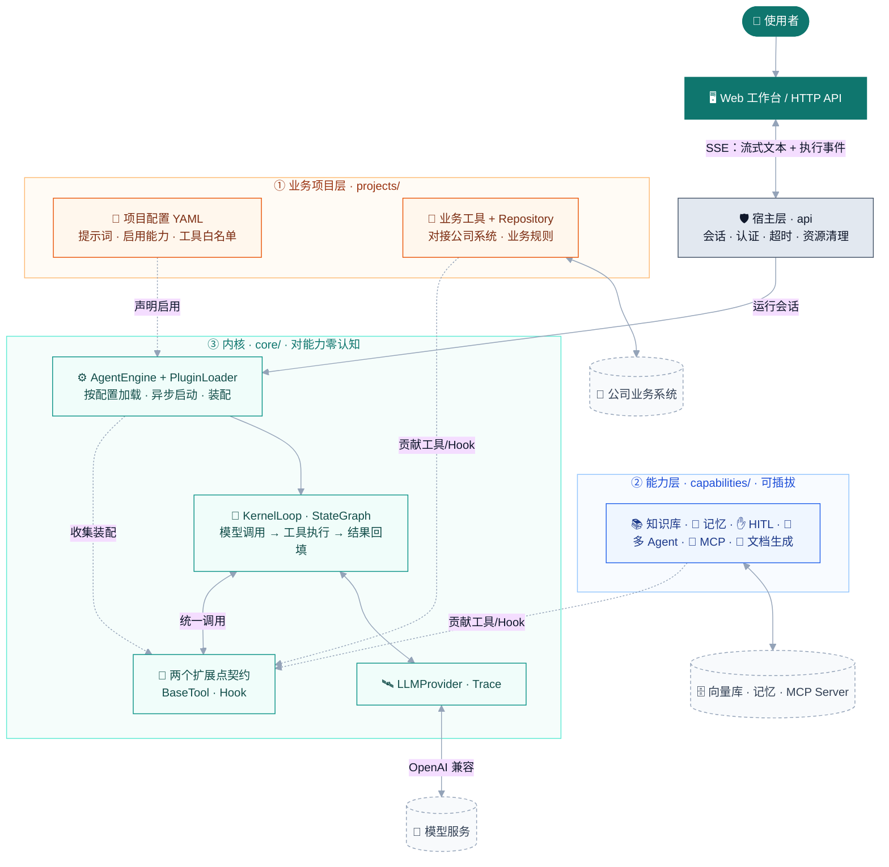

<div align="center">

# ARO · 阿洛

**Agent Runtime & Orchestration**

### 从意图，到执行。
*From intent to execution.*

[](LICENSE)
[](pyproject.toml)
[](https://github.com/langchain-ai/langgraph)
[](https://fastapi.tiangolo.com/)
[](frontend/)

Enterprise-grade Agent framework — minimal kernel, everything as a plugin, business composed at the project layer.<br/>
企业级 Agent 框架 —— **内核极简，能力皆插件，业务在项目层组合。**

[快速启动](#快速启动) · [整体设计](#整体设计) · [应用到你的业务](#应用到你的业务) · [路线图](ROADMAP.md) · [贡献指南](CONTRIBUTING.md)

</div>

---

ARO（阿洛）把「模型对话 → 工具调用 → 人工审批 → 执行记录」串成一条可运行、可追溯的业务链路。你通过配置组合能力（知识库、记忆、多 Agent、MCP……），在项目层对接自己的业务系统，无需改动框架内核。

仓库包含框架内核、HTTP API、Web 工作台，以及一个完整的 IT Helpdesk 业务实现（`projects/helpdesk/`）作为参考。

---

## 为什么是 ARO

市面上的 Agent 框架常见两种极端：要么是底层库（如裸用 LangGraph），企业级能力全要自己搭；要么是低代码平台（如 Dify），灵活性被框架锁死。ARO 取中间——**给懂代码的团队一套开箱即用、又完全可控的企业 Agent 底座**：

- **开箱即用**：知识库 RAG、人工审批（HITL）、长期记忆、多 Agent 编排、MCP 接入，都是现成能力，配置即启用。
- **完全可控**：代码驱动，不是拖拽；能力可插拔，不想要的一行不加载；新项目复用内核，只写业务。
- **生产就绪**：流式对话、执行追溯（Trace）、权限分级、人工审批、资源清理，面向真实业务而非 demo。

---

## 能力总览

| 能力 | 用途 | 形态 |
| --- | --- | --- |
| 模型对话与工具调用 | 对接 OpenAI 兼容模型，循环调用工具并整合结果 | 内核 |
| 人工审批 HITL | 写操作执行前确认参数，支持批准/拒绝/超时 | Hook |
| 知识库 RAG | 向量 + 关键词混合检索 + 重排序，返回带来源的片段 | 工具 |
| 长期记忆 | 身份边界内跨会话读写记忆 | 工具 + Hook |
| 多 Agent 编排 | 主 Agent 按意图委派给专项 Agent | 工具 + Hook |
| MCP Client | 接入现成 MCP Server 的工具 | 工具 |
| 文档生成 | 按模板生成 Word 报告 | 工具 |
| Web 工作台 | 流式对话、审批卡片、执行记录面板 | 宿主 |

能力是否启用由项目配置决定。轻量启动无需 GPU、检索模型或向量库。

---

## 整体设计

ARO 的架构是**三层 + 两个扩展点**。先看图，再看讲解——对着图能讲清整个设计。



### 对着图讲设计

**核心一句话：内核只会「跑一个 LLM 循环 + 提供两个挂载点」，它不认识任何具体能力。**

- **③ 内核（core/）**—— 最稳定、最小。`KernelLoop` 只做一件事：调模型 → 若模型要调工具就执行 → 结果回填 → 循环。它只认识**两个扩展点**：`BaseTool`（工具，模型按需主动调）和 `Hook`（Hook，框架在执行前后强制跑）。内核里没有任何 `if 知识库` / `if MCP` 这类分支——加能力永远不改内核。

- **② 能力层（capabilities/）**—— 所有可选能力都在这。每个能力贡献工具、Hook、或两者：知识库 = 一个检索工具；HITL = 一个审批Hook；记忆 / 多 Agent = 工具 + Hook组合。**不启用的能力，代码完全不加载**（连它的第三方依赖都不 import）。这就是"能力皆插件"。

- **① 业务项目层（projects/）**—— 业务在这里。项目配置 YAML 声明"用哪些能力 + 哪些工具"，项目代码写业务工具和 Repository（对接公司系统）。`projects/helpdesk/` 就是完整示例。新业务 = 新建项目目录，复用内核与能力，只写业务。

主循环使用 LangGraph StateGraph，相关依赖限制在 `core/kernel/`。每个 Engine 默认持有 MemorySaver，仅作为快照基础设施，当前不提供自动恢复或续跑；HITL 仍保持 Future 挂起审批。

- **装配流程**：`AgentEngine` 读配置 → 动态加载声明启用的能力 → 异步启动（如 MCP 建连接）→ 收集所有工具和Hook → 交给 `KernelLoop`，退出时统一清理资源。

- **宿主层（api/）**：管会话、认证、超时；前端通过 SSE 实时接收文本和执行事件。`Trace` 记录每次工具调用的参数、结果、耗时——**用来区分"模型说它做了"和"实际执行结果"**。

**依赖方向**：projects → capabilities → core 契约，单向。`core/` 不 import 任何具体能力或业务。详见[工程约定](docs/design/CONVENTIONS.md)。

### 一次「更新工单」请求怎么走

模型理解意图 → 选 `update_ticket` 工具并给参数 → HITL Hook拦截（写操作）→ 前端弹审批卡片 → 用户确认 → 才真正调业务数据源 → 结果回填模型 → 生成回答。拒绝或超时则不执行。全程进入 Trace。

> **模型负责理解和选工具，业务系统负责最终校验和状态更新。模型说"已完成"不等于真的执行了**——这是 ARO 把审批和 Trace 作为一等公民的原因。

---

## 快速启动

**环境要求**：Windows PowerShell、Python 3.11+、uv、Node.js 22 LTS、一个 OpenAI 兼容且支持工具调用的模型 API。以下命令从仓库根目录执行。

```powershell
# 1. 后端依赖（documents 用于本次启动的 Word 报告）
if (!(Test-Path .venv/Scripts/python.exe)) { uv venv --python 3.11 .venv }
uv pip install --python .venv/Scripts/python.exe -e ".[documents]"

# 2. 配置模型与访问令牌（首次）
if (!(Test-Path .env)) { Copy-Item .env.example .env }
notepad .env
```

在 `.env` 填写（保留你实际的模型名/地址/密钥）：

```dotenv
OPENAI_API_KEY=替换为模型服务密钥
OPENAI_API_BASE=https://api.deepseek.com/v1
DEFAULT_MODEL=deepseek-chat
DEFAULT_TEMPERATURE=0.7
# 应用访问令牌，与模型密钥不同，自行生成一个随机值
ARO_API_TOKEN=替换为你自己的随机令牌
```

```powershell
# 3. 构建前端（产物由后端托管，无需单独起前端服务）
Set-Location frontend; npm ci; npm run build; Set-Location ..

# 4. 启动工作台（模拟数据 + 审批 + Word，不加载知识库）
$env:ARO_API_CONFIG='projects/helpdesk/config/agent_workbench_light.yml'
.\.venv\Scripts\python.exe -m uvicorn projects.helpdesk.api:app --host 127.0.0.1 --port 8000
```

打开 http://127.0.0.1:8000/ ，在「访问令牌」填入 `.env` 里的 `ARO_API_TOKEN`。健康检查：http://127.0.0.1:8000/health 返回 `{"status":"ok"}`。

**试这几条**（当前为模拟 IT 工单数据）：

| 输入 | 预期 |
| --- | --- |
| `查询所有待处理的工单。` | 调用查询工具，显示数据与执行记录 |
| `将工单 TKT-001 分配给张三，优先级改为高。` | 弹审批卡片，确认后执行 |
| `为工单 TKT-001 生成 Word 报告。` | 确认后生成报告并提供下载 |

> 轻量配置没有检索能力，无法回答需要文档证据的法规问题。启用知识库见[部署与配置](docs/operations.md)。

---

## 项目结构

```text
aro/
├── core/            内核：Engine、KernelLoop、扩展点契约、LLM 接口、Trace
├── capabilities/    可插拔能力：知识库 / 记忆 / HITL / 多Agent / MCP / 文档生成
├── projects/        业务项目（helpdesk 为完整示例）
├── api/             HTTP、会话、认证、SSE、审批接口
├── frontend/        Web 工作台
├── scripts/         知识库入库等脚本
├── tests/           功能 / 安全 / 隔离 / 资源清理回归
├── docs/            部署说明与工程约定
├── models/ data/    本地模型权重与运行数据（不随源码提交）
└── pyproject.toml   依赖与工程检查配置
```

---

## 应用到你的业务

新业务放在 `projects/<业务名>/`，复用内核与能力，只写业务部分：

| 要改什么 | 改哪里 |
| --- | --- |
| 模型服务、密钥、运行参数 | `.env` / 部署环境变量 |
| 提示词、启用的能力、工具白名单 | 项目 YAML |
| 业务查询、写入规则、数据适配 | 项目的工具 / Repository / Capability |
| 跨业务复用的能力 | `capabilities/` |
| 会话服务与前端 | `api/` / 项目 API / `frontend/` |

对接公司系统时，按真实接口实现项目适配，使用真实系统的身份、权限和业务校验。涉及内核契约或装配边界的改动，先评估确认方案（见[工程约定](docs/design/CONVENTIONS.md)第 9 节）。

## 可选能力与运行边界

- 检索 `.[knowledge]`（本地 BGE 模型 + Qdrant）、MCP `.[mcp]`、Word `.[documents]`。装依赖不等于启用，仍需在项目 YAML 声明。
- 会话状态在进程内维护，当前单 worker；多 worker 不自动共享会话。
- API 共享令牌不替代业务用户授权；当前不含完整多租户权限。
- 长期记忆依赖服务端可信身份，不同用户不要共用同一身份。
- 写操作保留人工审批与上游校验。

## 维护验证

```powershell
uv pip install --python .venv/Scripts/python.exe -e ".[dev]"
.\.venv\Scripts\python.exe -m pytest -o addopts=''
.\.venv\Scripts\python.exe -m ruff check core capabilities api projects scripts tests
.\.venv\Scripts\python.exe -m mypy core capabilities api projects scripts
```

部分能力测试需对应可选依赖或外部服务。测试通过确认代码行为，不代替业务系统联调。

---

进一步阅读：[部署与配置](docs/operations.md) · [工程约定](docs/design/CONVENTIONS.md) · [Helpdesk 项目说明](projects/helpdesk/README.md) · [路线图](ROADMAP.md) · [贡献指南](CONTRIBUTING.md)

### 外部插件与完整生命周期

框架支持通过 Python `aro.capabilities` Entry Point 安装外部能力，仍由 YAML 显式启用。Hook 增加启动、会话加载、会话关闭和停止阶段；BaseTool 与 Capability 基类保持不变。配置示例、身份边界和宿主服务说明见[插件开发说明](docs/plugin-development.md)。v1.6 新增标准会话持久化插件，支持 Memory、SQLite、PostgreSQL。

### 会话持久化（v1.6）

安装 SQLite 支持：`uv pip install --python .venv/Scripts/python.exe -e ".[session-sqlite]"`，在项目 YAML 启用 `session_persistence` 并指定 `backend: sqlite`、`sqlite_path: data/sessions/helpdesk.db`。默认关闭保留数据，保留期 30 天；Memory 默认后端不跨实例持久化，PostgreSQL 使用可选依赖 `.[session-postgres]` 和环境变量 `ARO_DB_URL`。

宿主可用同一受信 `state.context.thread_id` 重建 Engine 恢复上下文，身份由框架校验。当前 API **不提供浏览器跨重启续聊**，也不会重放工具或恢复审批。完整配置、关闭/删除区别、运行示例与验证方法见[会话持久化说明](capabilities/session_persistence/README.md)；示例配置见 [agent_session_persistence.yml](projects/helpdesk/config/agent_session_persistence.yml)。
