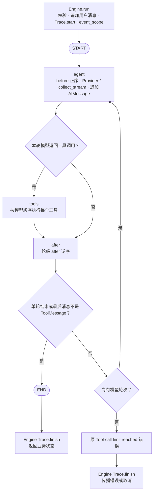

# 内核运行时与 StateGraph 驱动

本说明对应 v1.1 Phase 1 主循环迁移与 v1.2 Phase 2 依赖收口后的实现。公开入口仍为 `AgentEngine.run(user_input, state, *, max_tool_rounds=8, stream=False, on_event=None)`；单轮兼容入口为 `KernelLoop.run_once(state, *, stream=False)`。

## 驱动结构



before、模型、工具钩子或 after 若抛出原本不被处理的异常，也进入 Engine 收尾路径；取消继续向外传播。不会为了进入下一节点而强制补跑原来不触发的 after。

Engine 只调用一次图驱动，不再用 for 调用 run_once。run_once 使用同一张图的单轮模式，不保留第二份工具执行实现。每次调用构建并编译自己的图，节点闭包只引用本次运行帧；尚未做编译缓存优化。

## 工具钩子与权限

工具节点逐项执行：写入 tool_call_id → tool_call 事件 → before_tool 正序 → 权限判断/执行 → 追加 ToolMessage → after_tool 正序 → tool_result 事件。轮级 after 在工具批次结束后逆序调用。

因此两个Hook a、b 的顺序保持为：

```text
a.before → b.before
a.before_tool → b.before_tool
a.after_tool → b.after_tool
b.after → a.after
```

before_tool 首个 `(False, reason)` 中止后续 before_tool，拒绝执行工具并回写失败 ToolMessage；after_tool 仍按原顺序调用。授权异常继续转换成失败结果。没有处理 write 的Hook时，write 仍拒绝；forbidden 不进模型工具表也不可执行。bind_tools 仍只在装配时调用。

HITL 保持方案 A：before_tool 中等待 ApprovalManager 的 Future，审批 API 回调完成 Future，取消时沿原清理链回收。图不使用 interrupt、ToolNode 或工具自动重试。

### v1.4 工具边界与耗时

进入工具节点时先对整批调用深拷贝，阻止第一个钩子改写后续调用。`before_tool` 每次接收独立参数副本，工具执行也接收副本。事件 sink 接收参数/结果副本。`after_tool` 每次接收独立参数、结果和消息视图；内核保留真实 ToolMessage 和历史消息对象，忽略观察者的消息改写，仍允许 context 与外部存储写入。

`after_tool` 普通异常不会中断后续钩子、tool_result 或同批调用，诊断记录在调用的 `hook_errors`（hook_class/hook/error_type）；不记录原始异常文本。Trace 的既有四个钩子实现保留，由内核在完整观察链结束后补全权威结果、耗时与诊断，Trace 钩子自身失败也有记录兜底。`CancelledError` 继续传播；轮级 before/after 和事件 sink 的异常策略不变。

`BaseTool.timeout_seconds: float | None = None` 由内核的 `asyncio.timeout` 包住 `tool.run()`，不包含授权等待或观察钩子，无自动重试。超时生成失败 ToolResult 后继续处理同批调用。阻塞事件循环或主动吞取消的工具不受可靠硬截止保证，外部写入也不会自动回滚。

Trace 工具记录和 SSE tool_result 统一包含：

- `duration_ms`：本次调用总耗时，包含授权和观察链。
- `approval_duration_ms`：仅当 write 调用实际到达通用 `_handles_write` 授权Hook时记录整个 before_tool 阶段，包含同阶段其他钩子的开销；通过、拒绝、授权异常均记录。没有走审批则为 `None`，不是 0。
- `execution_duration_ms`：仅工具 run 的执行耗时（包含超时取消收尾）；拒绝、未知工具、无授权处理器而被拦截的 write 为 0。

前端执行记录保留总耗时，并分别展示授权与执行耗时。未完成的 tool_call 没有完成耗时字段，兼容旧历史记录。

## 状态与执行上下文

图私有状态仅含完整业务状态 business、本轮模型调用 calls、已完成轮数 rounds。business 为 LastValue 通道，不将 AgentState.messages 的 add_messages reducer 应用到整段历史，避免重复合并或复活已删除消息。能力继续接收原 AgentState，无图配置或图控制字段；消息对象引用保留，支持 multiagent 依赖 HumanMessage 对象身份的单轮预算。

每次运行在 event_scope 内复制一个独立 Context。三个节点的实际异步执行体通过 `asyncio.create_task(..., context=context)` 依次在同一个 Context 中执行，保证 before 写入的身份可被 tools 和 after 读取，事件 sink 也保持可见。不同运行互不共享这个 Context，调用者 Context 不被反向写入。节点直接 await 自己的执行任务，取消传播并等待任务结束，不创建游离工具或审批任务。

`KernelRun` 只保存最新 AgentState 引用，不进入图状态。Hook返回新状态后立即更新该引用；图在下一钩子或模型处失败时，Engine 仍能用最新状态结束 Trace。Trace.start/finish 继续由 Engine 对整个用户请求负责，一次请求只生成一份顶层 Trace。

context 的公开字典注解及 RuntimeContext 内部访问入口维持 debt1 的已批准方案，不调整身份校验或未知键。

## 轮次与当前边界

max_tool_rounds=N 保留旧语义：最多 N+1 次模型轮，最后允许的一批工具先执行，仍需下一轮时才抛出原错误。N=0 也允许第一批工具。图递归预算按最多每轮三个节点加余量设置，避免 LangGraph 默认递归限制提前替代业务错误。

主图已接默认 MemorySaver，定位为快照地基，**未实现恢复或续跑**。每个 Engine 持有独立 saver，在该 Engine 的多次 run 中复用；关闭时删除其自有 saver 中记录的线程。注入的外部 saver 由调用方管理连接、关闭、线程命名隔离及数据保留策略，Engine 不删除外部记录。

Engine 的构造器与异步 create 接受可选关键字 `checkpointer`，类型为 LangGraph 原生 BaseCheckpointSaver。内部 `_run` 将其传给 `graph.compile(checkpointer=...)`。独立调用 run_once 时使用本次运行的临时 MemorySaver，无需调用方管理连接或预设线程。

所有 invoke 都传 configurable.thread_id：有 context.thread_id 就沿用，缺失时通过 RuntimeContext 入口生成 UUID 并写回。没有从 checkpoint 回读再交给 run 的代码，没有 ainvoke(None) 或 interrupt。LangGraph 自身可能在每次 invoke 前读同线程旧快照，但 business/calls/rounds 均由完整显式输入重新覆盖；调用方 AgentState 是唯一业务权威状态。失败后的新请求仍从本次输入开始，不重放旧工具。

### PostgreSQL 切换口子

注入口只位于 core/kernel/engine.py；能力、项目与 API 不需要导入 LangGraph。将来由内核侧启动/部署装配代码打开原生 saver 后，通过 `await AgentEngine.create(llm_config, agent_config, checkpointer=saver)` 注入。

异步图调用要求 saver 实现 aget_tuple/aput/aput_writes 等异步方法。原生 PostgreSQL 家族中应使用 `langgraph.checkpoint.postgres.aio.AsyncPostgresSaver`，在其 `from_conn_string(...)` 异步上下文内完成 setup、运行及 Engine.close，再退出连接上下文。同步 `PostgresSaver` 虽继承 BaseCheckpointSaver，本机版本没有实现异步读取，不能直接当成 ainvoke 的异步后端。这里留的是原生接口口子，本轮未增加生产数据库配置、建立真实 Postgres 连接或宣称 PostgreSQL 已通过联调。

Phase 2 已删除从未接入的 `capabilities/hitl/checkpointer.py::PostgreSQLCheckpointer` 及其独占测试。主图方案 A 仍跑到底，checkpointer 不改变 HITL Future 审批机制，不开放恢复入口、不自动重放写操作。debt2 不在本轮范围内。

## Phase 2：第三方绑定只留内核

`capabilities/`、`projects/`、`api/`、`tests/` 均不直接 import LangGraph；原四个能力文件的豁免已清零。`core/kernel/checkpoint.py::default_checkpointer()` 统一默认 MemorySaver 构造，Engine 与单轮入口的生命周期、原生 saver 注入口及快照语义保持不变。内核检查点测试经此工厂构造 saver，并在内核模块上做白盒编译检查。

`core/kernel/store.py` 定义中立 `KVStore` 协议：`aput(namespace, key, value)` 与分页 `asearch(namespace, *, limit, offset)`，后者返回仅含实际 namespace/value 的 `KVItem`。默认 `InMemoryKVStore` 在构造时绑定 LangGraph InMemoryStore，并把第三方 item 转为中立 item；没有将第三方类型重新导出给能力。`shared_store(name)` 提供进程内按名字共享的默认后端，不承诺跨进程持久化。未启用 memory 时不会加载该 Store 模块或构造后端。

memory 仅依赖此中立边界，`MemoryCapability(config, *, backend=...)` 保留注入用法（backend 类型注解由 BaseStore 换成 KVStore）。身份命名空间、子命名空间排除、每页 100 条扫描、排序、输出上限和无去重保存均保留；后端连接生命周期仍由宿主管理。

multiagent 的 Supervisor 直接 await 注册的 AgentHandle，再经 `AgentResult.model_validate` 和 agent_name 一致性校验；移除单节点派发图，内核不增加派发适配层。委派权限、身份隔离、预算、超时、取消及嵌套 Trace/SSE 行为保留。

运行验证使用本机 langgraph 1.2.15，依赖文件本轮未修改。验证与源码边界证据见 [主循环迁移记录](../v1.1-stategraph-migration.md)、[检查点接入记录](../v1.1-checkpointer-validation.md) 和 [Phase 2 收口验证](../v1.2-phase2-containment-validation.md)。
