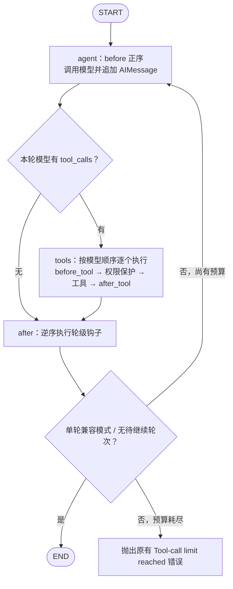

# v1.1 迁移提案：LangGraph 主循环与运行时上下文

日期：2026-11-02。状态：**待确认，尚未修改内核或能力实现**。

依据：[任务书](v1.1-langgraph-migration-brief.md)、[工程约定](design/CONVENTIONS.md)及当前源码。本文给出实现方案，并单列源码与任务约束之间的冲突；确认迁移方向不代表这些冲突自动获得豁免。

## 1. 结论与开工条件

建议以 LangGraph `StateGraph` 驱动所有模型轮次，保留自有工具执行逻辑、事件通道和扩展契约；HITL **选择 A，保持 Future 挂起**。默认使用内核持有的 `MemorySaver`。不引入原生 `interrupt()`，不实现跨进程恢复或写操作自动重放。

有两项开工条件需要先明确：

1. **当前测试基线不是全绿。** 本次两次迁移前全量运行均为 **183 passed、3 skipped、35 failed（221 项）**。必须先形成经确认的基线修正，再开始迁移；不能以迁移后仍有同样 35 项失败作为交付，也不能删掉测试或降低断言来满足数量。
2. **“能力代码不改”与“能力零 LangGraph import”在当前源码中冲突。** 不只是 multiagent，memory 和 HITL 也已有依赖。下文给出两条路径，请明确选择；没有确认时不移动这些实现、不自行扩大豁免。

不修改 `BaseTool`、`Hook`、`Capability` 的任何签名和语义；`AgentEngine.run`、`create`、构造器的现有调用方式继续兼容。本轮不提交 Git、不打 tag。

## 2. 迁移前实际状态

当前 HEAD：`526bef0e505f912bee263ab4d6edf5e02f0e99ab`。

工作树已有 10 份 helpdesk YAML 修改，以及未追踪的任务书和 `gemini_extract.txt`；这些是先有工作，本轮不覆盖、不回退。迁移方案基于当前 helpdesk 源码，不继续此前已中断的历史清理任务。

### 2.1 已完成的只读验证

| 项目 | 结果 |
| --- | --- |
| 完整阅读任务书与工程约定 | 已完成 |
| 读取主循环、Engine、状态、四个钩子、事件、流式、Trace、生命周期 | 已完成 |
| 读取 HITL 审批、快照，memory 与 multiagent 的身份传递实现 | 已完成 |
| `python -m pytest -q -o addopts=''` | 35 failed、183 passed、3 skipped |
| 再次全量，输出 JUnit 与简要日志 | 相同计数；`tmp/v1.1-baseline.xml`、`tmp/v1.1-baseline.txt` |
| `python -m projects.helpdesk.main --offline-demo` | 退出码 0，`query_tickets(status=open)`，实际返回 2 条，Trace 成功 |
| 本机依赖 | langgraph 1.2.15、langgraph-checkpoint 4.3.0、Postgres saver 3.2.0 |
| ContextVar 最小图实验（通过标准输入运行，未改源码） | 默认跨节点读取不到前节点写入；显式复用同一个独立 Context 后可读取，调用方 Context 未被污染 |

`pyproject.toml` 目前仅声明 `langgraph>=0.2.0`，不应假设所有历史版本都支持本机 API。实现时以验证过的版本确定兼容下界并记录；不在提案阶段升级环境或修改依赖。

### 2.2 既有失败的定位范围

- API/审批测试仍断言 `pending/approved`，当前 helpdesk 数据使用 `open/assigned/in_progress/resolved` 等状态。
- 部分内核 Trace、能力集成测试仍调用 `query_flight_ticket` 等旧工具，而现有项目提供 `query_tickets`、`update_ticket` 等工具。
- 检索测试的旧问题及预期片段与当前 IT 支持文档不匹配。
- 独立进程禁用依赖测试、报告测试、memory 隔离测试及共享检索资源计数也有失败，尚不能认定全部由上述因素导致。资源计数失败尤其要单独冷进程验证，区分真实残留与前置失败后的清理影响。

**处理建议**：先单独修正迁移前的业务/测试适配，保留身份隔离、禁用不加载、审批与资源归零等原安全含义。需要更新能力测试时，必须明确这是基线修复，不归入“迁移导致改写能力测试”。本提案只报告，不实施修复。

### 2.3 LangGraph 越界的完整清单

扫描使用 Python AST 遍历文件，而不只依赖默认 `rg`：`.gitignore` 中的 `memory/` 规则会让默认搜索遗漏该能力目录。

| 文件 | 已有依赖 | 当前任务如何处理 |
| --- | --- | --- |
| `capabilities/multiagent/supervisor.py` | `langgraph.graph` 的单节点委派图 | 任务书允许记录既有豁免；用户强调严格边界，仍须明确最终口径 |
| `capabilities/memory/capability.py` | `langgraph.store.base.BaseStore` | 任务书未给豁免 |
| `capabilities/memory/store.py` | `BaseStore`、`InMemoryStore` | 任务书未给豁免，现有 backend 注入及测试依赖该兼容性 |
| `capabilities/hitl/checkpointer.py` | `empty_checkpoint`，动态加载 PostgresSaver | 任务书未给豁免；它是已有快照工具，不是主图 checkpointer |

`projects/`、`api/` 当前未发现 LangGraph 直接 import。

**边界决策有两种，不能同时承诺两者：**

- **严格收口，符合用户强调的铁律（建议方向）**：把已有 LangGraph 存储/快照/委派图依赖也收进 `core/kernel/` 内部，能力只通过中立适配面调用。这需要明确批准有限的能力实现修改及适配面设计，虽然三个扩展契约不变，却超出了“能力实现完全不动”。确认选择该方向后，先补充具体搬迁接口、兼容性与文件清单，获得确认再实施；本提案不把它视为已经授权。
- **先保持能力原样迁主循环**：仅新增主循环相关 LangGraph 用法到内核；对上表 4 个既有能力文件建立限定豁免，不能新增扩散。这样能满足迁移不改能力，却**不满足本轮严格零 import 验收**。只有用户明确批准修订验收口径才能采用，不擅自按 multiagent 豁免类推 memory/HITL。

其余章节描述可共用的主循环设计，不依赖先采取哪一种边界方案。不会通过 `importlib`、字符串导入或上层重导出伪装零 import。

## 3. StateGraph 结构

将 `Engine.run()` 的多轮 `for` 改为一次图调用。保留 `KernelLoop` 作为内核门面，其内部持有图构建/调用逻辑；不使用 LangGraph `ToolNode`，以免跳过自有权限、审批和事件语义。

图中一个“轮”对应迁移前的一次 `run_once`，不是一次用户请求。单次用户请求通常包含“模型选工具”和“模型根据结果回答”多个轮。

### 3.1 四个钩子逐项映射

| 钩子/步骤 | 执行位置与顺序 | 必须保留的语义 |
| --- | --- | --- |
| `bind_tools` | 装配时，为Hook传入过滤后的工具表副本 | 不搬到每轮或每次工具调用 |
| `before` | `agent` 节点开头，按声明顺序 await | 每个模型轮触发，可返回新 state，后续步骤使用其返回值 |
| 模型调用 | `before` 全部成功后 | 流式仍用 `collect_stream`，非流式仍用 Provider；保留 `loop.llm` 替换入口 |
| `before_tool` | `tools` 节点逐个工具，正序 | 先写 tool_call_id、发 tool_call，再执行；首个拒绝即停止后续 before_tool |
| 工具拒绝/执行 | 同一节点、同一工具边界内 | 保留授权异常转失败、未知工具失败、无 HITL write 拒绝及工具异常处理 |
| `after_tool` | 追加该工具 ToolMessage 后，正序 | 拒绝或执行失败也调用；每个调用仅一次；接受返回的新 state |
| `tool_result` | 所有 after_tool 完成后 | 原字段与事件顺序；耗时包括审批等待，不自行改口径 |
| `after` | 独立 `after` 节点，逆序 | 无工具、工具成功/拒绝/失败的正常轮均触发，不变成“一次请求只触发一次” |

不新增异常路径的强制 `after` 调用：当前 `before`、LLM、`after_tool`、`after` 抛出未处理异常时，原路径会中止；保持异常/取消传播。原来被工具执行逻辑转换成 `ToolResult` 的错误仍按原规则转换。

`agent` 必须记录模型原始返回的本轮调用列表，不能假设在Hook修改状态后最后一条消息仍是该 AIMessage。完成 `after` 后，多轮继续条件兼容当前“最后一条是否 ToolMessage”的判断，避免Hook返回新状态造成行为变化。

### 3.2 轮次上限与单轮调用兼容

当前 `max_tool_rounds=N` 实际允许最多 **N+1 次模型轮，并执行最后一轮返回的工具**，之后仍需继续才报错。例：N=1 的持续工具调用会执行 2 批工具；N=0 仍允许第一批执行。这虽有命名歧义，本次不修正。

内部使用独立计数器，每次完整模型轮后计数，在 `after` 后决定继续或抛出原错误 `Tool-call limit reached; simplify the question`。负数仍在调用模型前拒绝。LangGraph `recursion_limit` 按图节点数留出余量，不让默认步数限制提前替代业务轮次限制。

保留 `KernelLoop.run_once(state, stream=...)`：走相同图节点，完成一轮后 END，不保留另一套手写执行实现。已有单轮契约测试、流式测试和独立 Trace 用法无需为迁移重写。

## 4. 状态模型与 ContextVar 跨节点问题

### 4.1 图私有状态与业务状态分开

对能力继续传同一形态的 `AgentState`，绝不把 LangGraph 配置、计数器或检查点元数据塞进能力 context。

图使用内核私有 `GraphState`，以一个 **LastValue 的业务 state 容器**承载完整 AgentState，另存本次轮次等可序列化的控制字段。节点返回完整业务状态替换该容器，**不把 AgentState.messages 的 add_messages reducer 直接用作图的累加通道**。

原因：当前Hook会直接修改、替换消息列表，API 又会传入已有完整历史；若每节点都把完整历史交给 add_messages，可能重复消息、无法删除临时记忆，或在重新加载时改变引用。AgentState 的既有 reducer 注解不需要为此改动。

单次运行内保留业务消息对象引用，尤其 multiagent 用最近 HumanMessage 的对象身份维持“一轮一次委派”预算，不能每个节点序列化再反序列化。检查点是快照，不能反过来替换正在运行的对象。返回 state 不含图私有字段。

### 4.2 每次请求持有独立执行 Context

原 memory 在 `before` 内设置 ContextVar，搜索工具在随后读取；multiagent 同样通过 scope 保存身份和委派预算。LangGraph 节点任务默认只继承上下文，不把写入回传给其他节点。仅靠同一个 `AgentState.context` 不能解决它。

建议在内核为每次图调用建立私有运行帧：

- 在 `event_scope(on_event)` 内 `copy_context()`，得到单次运行专属 Context。
- `agent`、`tools`、`after` 的实际执行体通过内核包装器在**同一个 Context 对象**中串行运行；Python 3.11 的 `asyncio.create_task(..., context=...)` 可用于此处。不能每节点再 copy 成互不相通的 Context。
- 同一运行不并行执行节点或工具；不同 Engine/请求各有独立 Context，子 Agent 继续沿用现有事件转发与身份隔离。
- 节点等待取消时取消并回收其执行体，不遗留孤儿任务。运行帧不放入图 state 或 checkpoint；Future、回调、ContextVar、模型客户端、Capability 对象均不序列化。
- 图节点引用当前运行帧的绑定必须是单次调用作用域。初版可通过每次调用的节点闭包构建/编译图，编译复用只在不混淆作用域且有证据时优化；不使用全局“当前用户”。

这保留能力内部原有 scope 行为，同时保持父调用 Context 不被反向污染。它是迁移适配，不声称已完成“三套注入机制合一”。实现后必须用真实 memory/multiagent 端到端用例复验；当前最小实验仅证明机制可行。

## 5. HITL 选择 A，事件与 Trace 保持

`tools` 节点在原时机 await `before_tool`；HITL 内部继续创建 Future、发 `approval_required` 并等待 `/approve` 回调。不改 ApprovalManager、HITL Hook或审批 API；不使用 `interrupt()`，不把 Future 持久化。

采用方案 A 的理由：普通异步节点可以等待外部 Future，不妨碍其他会话；保留原审批 token、工具参数和取消清理链路，比迁移到可重放中断语义更符合行为对等。节点可能长时间 await，不等于跨进程暂停后恢复。

保留 `emit_event + ContextVar + collect_stream`，不接 LangGraph 的消息流作为对外 SSE。`token`、`tool_call`、`tool_result`、审批及专项 Agent 事件的名称、字段、顺序保持；保留事件回压与请求取消传播。

Trace 仍由 Engine 在用户请求开始时 `start`，结束/异常/取消时 `finish`，覆盖所有图轮次。它在Hook列表中的顺序保持。内核运行帧保留最新业务 state，即使节点抛错、图未返回，也能正确结束该轮 Trace；不能仅在图调用成功后更新 Engine 局部变量。一次请求只收尾一次，禁止每个模型节点产生一份顶层 Trace。

## 6. Checkpointer 接入与边界

### 6.1 默认接入

新增内核内部检查点适配文件，例如 `core/kernel/checkpoint.py`。编译图时接入 `MemorySaver`，`configurable.thread_id` 使用 `context["thread_id"]`。默认 saver 由每个 Engine 持有，不做全局共享；关闭时清理它拥有的线程记录，避免会话过期后保留聊天和身份。

不把现有 `capabilities/hitl/checkpointer.py` 直接拿来当图 saver：它是包装 `{"state": ...}` 的独立快照工具，与完整图的 checkpoint/pending-writes 协议不同。它的边界迁移须按第 2.3 节另行确认。

### 6.2 外部 state 与检查点历史不双写合并

现有 `engine.run(input, state)` 的显式业务状态继续为本次请求的权威输入；API 提交成功轮后才更新 session.state。每次调用为图控制字段初始化新计数，整份替换图的业务状态容器，不再将同一历史 append 到检查点已有消息中。

失败/取消可能已留下中间检查点，下一次普通 run **不得自动续跑**它或执行挂起的写工具；普通调用从本次显式输入开始。`state=None` 仍创建新会话/thread_id，不隐式加载上次历史。当前未提供恢复入口，不开放无审核的 `ainvoke(None)`。

### 6.3 持久化切换口子

将 saver 创建集中在内核内部工厂/受保护方法，默认返回 MemorySaver；将来可替换为支持异步图调用的 saver。此次不在公开 Engine 签名、API 配置或 Capability 契约暴露 LangGraph 类型，也不增加 Postgres 配置开关来假装已经支持持久运行。

外部注入 saver 时必须区分资源所有权、跨 Engine thread 隔离和删除策略；此版本仅完成默认内存模式及测试注入，不承诺任意共享 saver 生产可用。

### 6.4 禁止副作用自动重试

图的工具节点不启用自动重试或恢复重放。审批批准后执行过的写操作，不能因检查点失败而自动再执行；保存失败要传播，成功执行事实仍应被 Trace/现有业务记录观察到。MemorySaver save/load 验证不代表 exactly-once，也不代表审批可跨进程恢复。

## 7. 债 1：RuntimeContext 类型化

在 `core/kernel/state.py` 定义 `RuntimeContext(TypedDict, total=False)`，保持字典读取方式：

| 字段 | 类型 | 来源 |
| --- | --- | --- |
| `thread_id` | `str` | 宿主提供；缺失时 Engine 生成 |
| `tenant_id`、`user_id` | `str \| None` | 可信宿主身份，保留缺失/None 语义 |
| `trace_id` | `str` | Trace 创建 |
| `tool_call_id` | `str` | 内核当前工具调用 |
| `parent_thread_id` | `str` | 子 Agent 的父会话 |
| `delegation_depth` | `int` | 子 Agent 深度 |
| `extra` | `dict[str, Any]` | 新增非身份临时数据，不放连接、回调或 Future |

Engine、loop 和 Trace 的内核写入统一使用构造/访问辅助函数，消除散落的 `setdefault("context", {})`。保留顶层 `state.tenant_id` 的既有兼容行为，不自行调整租户冲突判定。

**静态兼容点必须说明**：已有能力会把 `dict[str, object]` 作为 context 传入，部分测试也会传未知字段。直接把公开 `AgentState.context` 缩窄为封闭 TypedDict，会要求修改这些生产者，并改变现有类型契约。

建议采用阶段性边界：`AgentState.context` 接受 `RuntimeContext | dict[str, Any]` 的既有映射输入，内核自己创建及写入的上下文使用 RuntimeContext。辅助函数保留未知键的原位置，不能把旧键强行移到 extra。不得因本次类型化自动填默认身份、丢弃数据或把原来由能力拒绝的无效身份变成有效身份。

这提供内核已知字段的静态约束，**不宣称 TypedDict 提供运行时身份校验或所有上层代码已强类型化**。如果验收要求公开 context 也必须完全封闭，则需要明确批准最小生产者类型注解适配；不能用大量 cast、type: ignore 或改能力语义绕过。请求确认此阶段性方案。

## 8. 债 2：本轮不统一三套运行时注入

三者职责并不相同：`bind_tools` 传装配期工具表；state.context 传可记录的业务身份；ContextVar 为不接收 state 的 `BaseTool.run(**kwargs)` 提供任务局部信息，并承载事件 sink。

把身份统一塞进工具参数会把可信身份暴露给模型；为工具增加 runtime 参数则违反契约；让能力去读新的全局 scope 又会牵动多个实现。本轮保留这些边界，做类型化及上述节点上下文适配。真正移除能力私有 ContextVar 留待后续独立讨论，不借迁移扩展范围。

## 9. 预计改动范围

| 位置 | 主循环迁移的预计变更 |
| --- | --- |
| `core/kernel/state.py` | RuntimeContext 与内核访问辅助函数 |
| `core/kernel/loop.py` | StateGraph、节点、路由、单轮兼容门面 |
| `core/kernel/engine.py` | 一次图调用替换 for 循环，运行帧与检查点生命周期 |
| `core/kernel/trace.py` | 使用统一 context 访问，不改 Trace 输出语义 |
| 新增 `core/kernel/checkpoint.py` | 默认 saver 与内核替换口子 |
| 必要时新增内核私有运行辅助文件 | 单次请求 Context 与取消回收，不做通用调度器 |
| 内核测试 | 新增图行为、检查点与上下文回归，保留现有测试 |
| `docs/design/` 与验收文档 | 内核运行时说明、可复查证据 |
| `pyproject.toml` | 经验证后必要的依赖兼容范围，不盲目全量升级 |

`BaseTool`、`Hook`、`Capability` 文件不改签名和语义；主迁移不要求改 API/SSE/前端。第 2 节的存量边界搬迁与基线修复须另列变更，不藏进本表，也不先实施。

## 10. 实施与验收计划

确认提案及开工条件后按顺序执行：

1. 单独处理基线失败，核实每个根因，建立全绿的当前业务基线与源码哈希；能力测试若需适配既有业务变更，先获得对应授权并与迁移分开记录。
2. RuntimeContext 小步引入，验证旧字典访问、非法身份拒绝、用户/租户冲突和未知键保留。
3. 迁移图节点、四个钩子和多轮路由，保留单轮入口、流式/事件、Trace 与 HITL A。
4. 接入内存 checkpointer、生命周期，验证多轮/多会话不重复与失败后不重放。
5. 完成全量、架构、类型、CLI 与浏览器验证，更新运行说明与验收报告。总数量不得少于修正后的绿色基线，不删除能力测试来满足计数。

新增验证必须覆盖：

- 两个Hook、多个工具的完整钩子/事件顺序，拒绝、异常、状态替换及未知工具；write 无 HITL 拒绝，forbidden 不可见不可执行。
- N=0、N=1、默认预算、最后一次无工具回答的边界；错误文本及 Trace 收尾保持。
- 显式传入完整历史、重复消息内容、Hook删除消息时不重复、不复活已删除内容；图私有字段不泄漏给能力。
- MemorySaver 可实际保存并加载含消息与 context 的快照；两个 thread 隔离、相同 thread 连续 run 不重复，失败后新请求不自动重放写入，关闭后自有记录释放。
- memory 身份从 before 到工具再到 after 可见；multiagent 的一轮委派预算、父子事件及不同用户并发隔离。
- HITL 同意/拒绝/超时/断连、取消图节点时 Future 与工具执行体均被回收；Engine close 的既有多等待者取消清理测试保持。
- `loop.llm` 替换生效，SSE token 拼接与完整流校验保持；消息对象身份不会错误重置委派预算。
- AST 扫描加不受 ignore 影响的文本扫描，包含动态导入；按已确认边界验收，不能仅展示漏掉 memory 的 grep 输出。
- 三个扩展契约及能力代码/测试哈希对比；单列已明确批准的基线修正或边界搬迁。

质量命令以当前项目为准：`pytest`、`ruff`、`mypy`、helpdesk 离线 CLI；工作台亲测查询、更新审批、报告下载和历史。真实远端模型/数据库验证分别说明环境与结果，不用离线结果替代。

## 11. 请求确认

请确认主迁移方案：StateGraph 的 agent/tools/after 结构、HITL A、保留事件通道、默认内存检查点、不自动恢复或重试工具。

同时需要明确：

1. 存量越界依赖选择**严格收口并先补边界搬迁提案**，还是**明确批准四个既有文件的限定豁免**；后者将改变严格零 import 验收口径。
2. 是否同意先单独修正当前 35 项失败的基线，并接受 RuntimeContext 的阶段性兼容输入方案。

在这些冲突明确前，不修改内核或能力。依据工程约定第 9.7 条：“改接口要喊停……先说明原因和影响范围，不要默默改掉导致其他实现对不上。”任务书同时要求“与现有契约或测试冲突时……先喊停给提案”。
